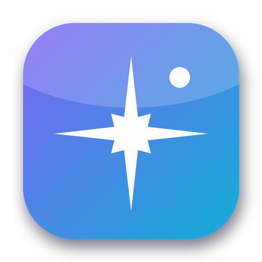
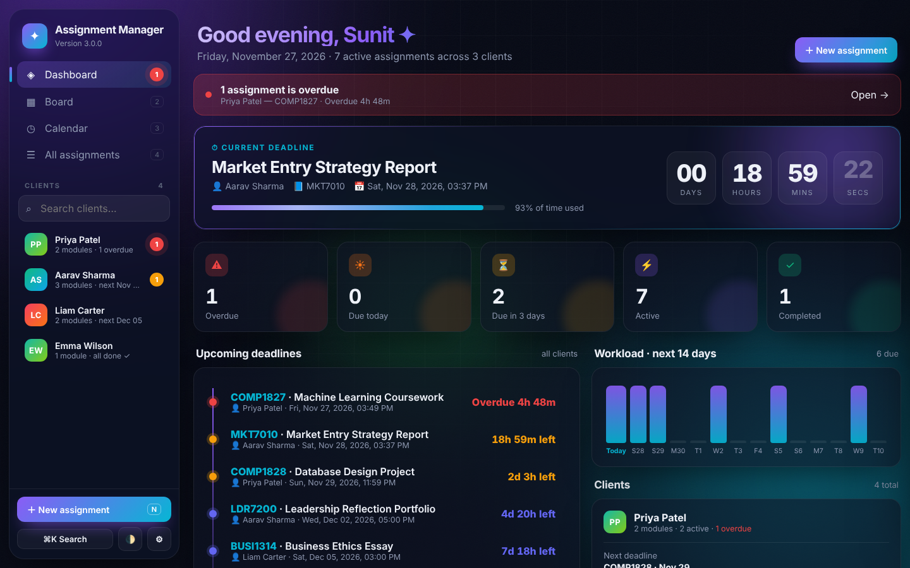
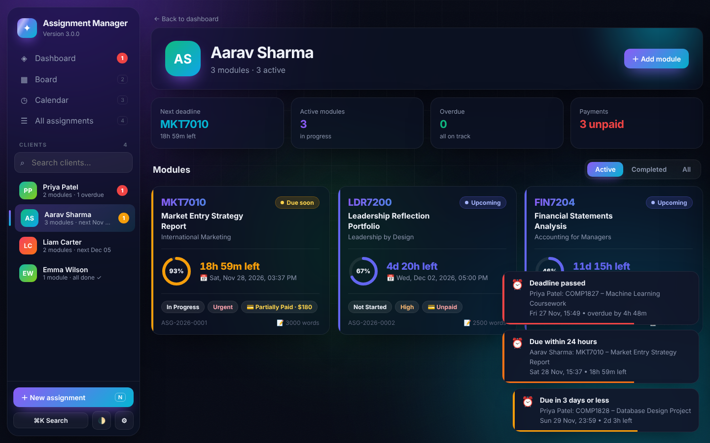
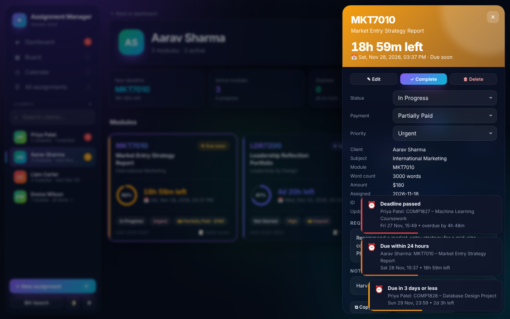
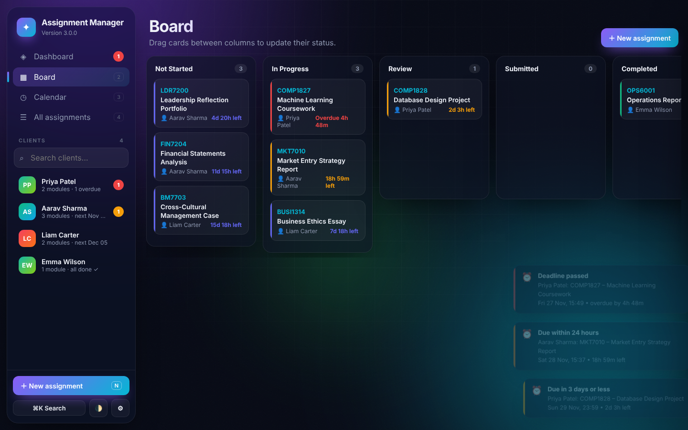
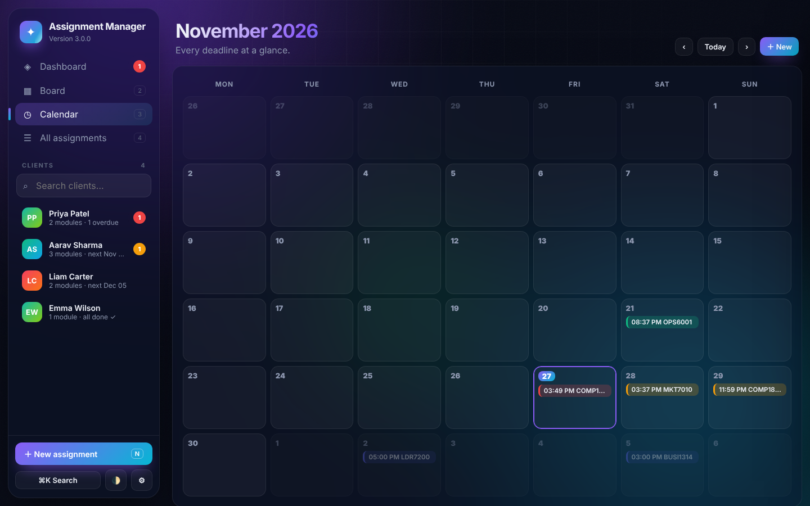
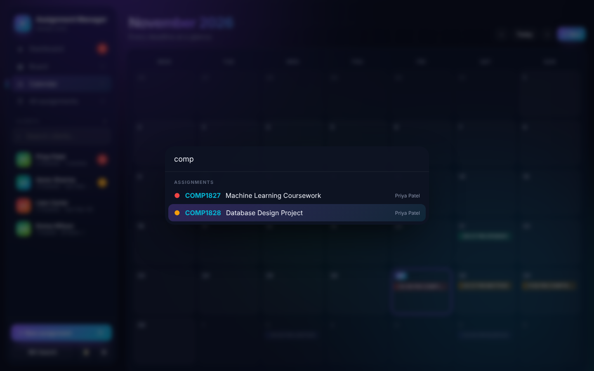
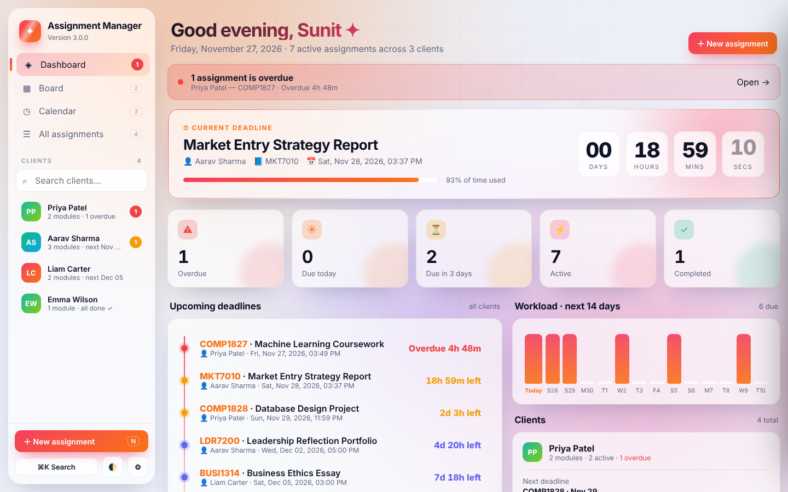

<p align="center">
  
</p>

<h1 align="center">Assignment Manager</h1>

<p align="center">
  A beautiful, client-first desktop app for tracking assignments, modules and deadlines,<br>
  with live countdowns, smart reminders and a Claude AI extension.
</p>

<p align="center">
  
  
  
  
</p>



## Features

- **Client-first:** every client in the sidebar, with module count, next deadline and an overdue badge. Click a client to see only their modules.
- **Live current-deadline hero:** a ticking days / hours / minutes / seconds countdown, plus a progress bar showing how much of the available time has been used.
- **Smart reminders:** native desktop notifications N days before a deadline (you choose N), 24 hours before, 1 hour before, and when it's overdue. Each reminder is sent once and resets if the deadline changes.
- **Every detail:** auto ID (`ASG-2026-0001`), client and contact, module code, subject, word count, assigned date, deadline, priority, status, fee, payment status, requirements and notes.
- **Five views:**
  - Dashboard: stats, a timeline, a 14-day workload chart and client cards.
  - Client page: module cards with progress rings.
  - Board: a Kanban board where you drag cards between statuses.
  - Calendar: a month view of all deadlines.
  - All assignments: searchable and filterable.
- **Fast:** a ⌘K command palette and keyboard shortcuts (`N` new, `1`–`4` switch views, `D` dark/light, `/` search clients).
- **Looks the part:** animated aurora backgrounds, frosted-glass panels, staggered entrance animations, count-up numbers, confetti when you complete something, and five colour themes in dark or light mode.
- **Private by design:** everything is stored locally in SQLite (`~/.assignment_manager/assignments.db`), and the API is bound to `127.0.0.1` with a per-launch token.
- **Claude extension:** ask Claude "what's due this week?" or "add a module for Priya due Friday 5pm" and it updates the same database.

| Client page | Details drawer |
|---|---|
|  |  |

| Board (drag & drop) | Calendar |
|---|---|
|  |  |

| Command palette | Light mode, Sunset theme |
|---|---|
|  |  |

## Install

### macOS
1. Download `AssignmentManager-macOS.zip` from [Releases](../../releases), unzip it, and drag **Assignment Manager.app** to **Applications**.
2. The first time only, right-click the app and choose **Open**. If macOS still blocks it, go to **System Settings → Privacy & Security → Open Anyway**. Alternatively, run:
   `xattr -dr com.apple.quarantine "/Applications/Assignment Manager.app"`
3. On first launch the app installs its native-window component (`pywebview`) into `~/.assignment_manager/venv`, which takes about a minute. After that it opens instantly.

You need Python 3.9+ from [python.org](https://www.python.org/downloads/macos/).

### Windows / Linux / from source
```bash
git clone https://github.com/Sunit127/assignment-manager.git
cd assignment-manager
python3 app/assignment_manager.py
```
The app opens in a native window (pywebview is installed automatically on first run). If that isn't possible, it falls back to a Chrome or Edge app window.

### Claude extension (optional)
Double-click `assignment-manager.mcpb` (from Releases, or run `python3 scripts/build.py`) to install it in the Claude desktop app. It gives Claude seven tools:
- `get_summary`
- `get_upcoming_deadlines`
- `list_assignments`
- `get_assignment`
- `add_assignment`
- `update_assignment`
- `delete_assignment`

## Project structure

```
app/
  assignment_manager.py   # Python backend: SQLite, JSON API, reminders, window
  ui/index.html           # The whole interface: HTML + CSS + JS, no frameworks
claude-extension/
  manifest.json           # Claude Desktop extension manifest (MCPB)
  server/main.py          # Zero-dependency MCP server over the same database
scripts/build.py          # Builds the single-file app, macOS .app, and .mcpb
docs/                     # Screenshots and icon (fictional demo data)
```

## Build

```bash
python3 scripts/build.py      # -> dist/
```
This produces:
- `dist/assignment_manager.py`: one self-contained file with the UI embedded.
- `dist/Assignment Manager.app` and `AssignmentManager-macOS.zip`: the macOS app.
- `dist/assignment-manager.mcpb`: the Claude extension.

## How it works

The Python backend uses only the standard library. It serves the UI and a small JSON API on `127.0.0.1` (random port, token-protected), and runs a reminder thread that sends native notifications through `osascript` on macOS, PowerShell toasts on Windows, or `notify-send` on Linux. The UI polls a change signature every few seconds, so edits made from Claude appear in the app almost immediately.

## License

MIT © Sunit Sah
